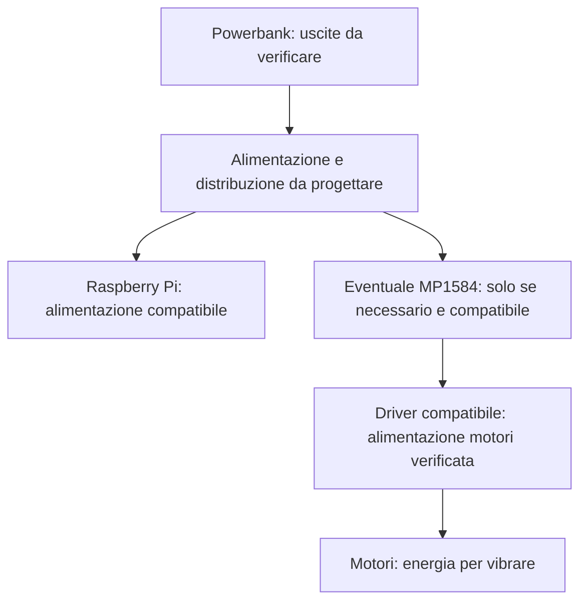

# HAMDA — Da dove iniziare, passo per passo

Il primo obiettivo pratico è vedere **un solo motore** accendersi e spegnersi
con un comando. Per arrivarci useremo prima il programma senza collegare i
motori, poi prepareremo la prova fisica dopo aver verificato i componenti.

Non serve comprare altro adesso. Prima dobbiamo capire bene cosa hai già e
quali caratteristiche richiedono i motori.

## Dove siamo

- Il programma attuale controlla **16 motori simulati**: esistono nel programma,
  ma non sono ancora collegati a motori veri. La verifica iniziale ha superato
  **49 test automatici**.
- Hai dichiarato di avere **4 schede PCA9685**, **12 moduli chiamati DM0018x8**
  e, in precedenza, **50 motori vibranti** (conteggi aggiornati il 28 ottobre 2026).
  Il modello dei 12 moduli è da identificare: l'associazione automatica ai
  DRV8833 della foto precedente è stata ritirata.
  Ci sono anche moduli MP1584EN. L'[inventario](hardware_inventory.md) raccoglie
  le informazioni già ricevute: non occorre ricominciare da zero.
- L'espansione a **32 motori** è una proposta successiva. La scelta non serve
  per iniziare e il programma attuale rimane da 16.
- La parte di programma che comunica con le schede reali **non è ancora
  scritta**. Un test simulato riuscito non fa partire l'hardware.

## A cosa serve ogni pezzo

| Pezzo | Cosa fa, in parole semplici |
| --- | --- |
| **Raspberry Pi** | È il computer. Esegue il programma Python e decide quale motore deve funzionare, con quale intensità e per quanto tempo. |
| **PCA9685** | Riceve gli ordini dal Raspberry e produce 16 segnali di comando chiamati PWM. Non fornisce direttamente la potenza necessaria ai 16 motori. |
| **DM0018x8** | È il nome che hai indicato per 12 moduli. Prima di attribuire loro una funzione o un numero di canali dobbiamo riconoscerli da una foto leggibile. |
| **DRV8833** | È il driver: usa i segnali di comando per pilotare i motori tramite la loro alimentazione. Un modulo può pilotare **due motori DC indipendenti**, se il tipo di motore e il carico sono compatibili. I due motori possono ricevere comandi diversi. |
| **MP1584EN** | È un convertitore che può abbassare una tensione di alimentazione. Non decide quando vibrare e non sostituisce il driver. La sua uscita va regolata e **misurata** prima di collegarla al carico previsto. |
| **Powerbank** | È una sorgente di energia. Le uscite effettive e la capacità di alimentare Raspberry e motori vanno verificate sul modello disponibile. Non presumiamo la tensione di una porta USB o la compatibilità dal solo connettore. |
| **Motore vibrante** | È il pezzo che produce la vibrazione. Per scegliere come alimentarlo servono il suo tipo e le sue caratteristiche, non soltanto la forma o la dimensione. |

### Gli ordini e l'energia seguono due percorsi

Il primo schema mostra **chi dà gli ordini** nel sistema previsto:


Il secondo mostra **da dove deve arrivare l'energia**:



Sono schemi per capire i ruoli, **non istruzioni di cablaggio**. Non definiscono
pin, tensioni, collegamenti delle masse o alimentazione delle singole schede.
Il convertitore è una possibilità da valutare: possederlo non significa che
debba essere inserito nel circuito. Il progetto elettrico completo viene dopo
la verifica dei componenti. Il DRV8833 è descritto perché compariva sulla
confezione fotografata, ma non è confermato che corrisponda ai 12 DM0018x8.

## Il percorso di lavoro

| Passo | Cosa fai tu | Cosa preparo io | Quando il passo è riuscito |
| --- | --- | --- | --- |
| **1. Identificare i pezzi** | Prepari un unico gruppo di foto leggibili dei motori e delle loro indicazioni tecniche, delle etichette delle uscite del powerbank e dei modelli delle schede. | Aggiorno l'inventario con i dati leggibili e distinguo ciò che manca da ciò che sappiamo già. | I modelli disponibili sono identificati e sappiamo quali caratteristiche elettriche restano da verificare. |
| **2. Preparare il Raspberry** | Controlli se si avvia e mostra il desktop o il terminale. Prima di un'eventuale reinstallazione conservi i dati della microSD. | Adatto le istruzioni alla situazione del tuo Raspberry; stiamo chiarendo se il sistema operativo è già pronto. | Il Raspberry si avvia e può eseguire Python. |
| **3. Provare il programma senza hardware** | Apri la cartella completa del progetto sul PC o sul Raspberry ed esegui la breve prova sotto. | Correggo eventuali problemi del programma o delle istruzioni, usando il messaggio esatto dell'errore. | Vedi 16 motori virtuali; attivazione, scadenza e STOP funzionano; i test terminano senza errori. |
| **4. Preparare la prova fisica** | I componenti e il circuito vengono verificati prima di alimentare i motori. | Dopo la verifica elettrica scrivo il collegamento software con le schede reali e preparo la prova limitata a un motore. | Un motore sul banco risponde ai comandi e si spegne correttamente; i risultati sono verificati, non soltanto mostrati a schermo. |
| **5. Aumentare gradualmente** | Provi prima due motori con comandi diversi, poi il gruppo da 16. | Estendo e verifico i controlli necessari. Un eventuale passaggio a 32 avrà configurazione e test propri. | I motori rispondono indipendentemente e alimentazione, arresto e comportamento del gruppo sono verificati. |
| **6. Preparare gli esperimenti** | Definisci quali segnali vuoi confrontare e cosa osservare durante le prove. | Aggiungo pattern e registrazione delle prove dopo aver verificato la fase precedente. | Le prove si possono descrivere e ripetere con risultati registrati. |

Ogni passo usa il risultato del precedente. Non occorre decidere ora i pattern,
la disposizione sui piedi o se usare 32 motori.

## Preparare il Raspberry senza perdere i dati

Per ora non serve accendere i motori né collegare le schede al Raspberry.

Se il Raspberry si avvia già, partiamo dal sistema presente. Se invece dovesse
servire installare Raspberry Pi OS, prima si controlla il contenuto della
microSD e si crea una copia dei dati da conservare. Scrivere un'immagine del
sistema sulla scheda può cancellarne il contenuto: non è un passaggio da fare
automaticamente per provare questo programma.

Le istruzioni di installazione del sistema operativo dipendono dallo stato del
tuo Raspberry. La versione effettiva di Raspberry Pi OS e quella di Python sul
dispositivo sono ancora da verificare.

## Cosa significa verificare il circuito

Prima della prova fisica dobbiamo conoscere la tensione richiesta dai motori,
la corrente che assorbono e i limiti delle schede effettive. Le foto permettono
di identificare i prodotti; i dati mancanti vanno cercati nella documentazione
del produttore o misurati con strumenti adatti.

Per esempio, l'uscita di un MP1584EN regolabile non si conosce guardando la
scheda: deve essere controllata con un **multimetro**, lo strumento che misura
la tensione, prima di collegare il motore. Se non sai usarlo, prepariamo quel
passaggio separatamente e serve qualcuno che possa eseguire o controllare la
misura sul posto. Io posso aiutare a interpretare i dati e preparare le
istruzioni, ma non eseguire una misura fisica a distanza.

I fili dei motori andranno alle uscite dei driver, secondo lo schema verificato.
I pin del Raspberry e i segnali del PCA9685 servono a dare comandi, non ad
alimentare direttamente i motori.

## Portare sul computer la cartella giusta

Il codice preparato in questa chat è nella cartella locale del progetto. Alla
prima verifica il repository remoto su GitHub risultava vuoto; questa versione
non è stata pubblicata su GitHub dall'assistente. Per usare i file preparati
qui puoi partire dal pacchetto ZIP descritto sotto.

Per eseguire il programma altrove devi trasferire la cartella completa del
progetto, non soltanto `main.py`. Il pacchetto
`HAMDA-simulatore-0.1.0.zip` raccoglie il progetto da estrarre. Sul Raspberry
possiamo chiamare la cartella `HAMDA` e metterla nella cartella personale:
`~/HAMDA` è una convenzione comoda, non un percorso obbligatorio.

Prima dell'avvio controlla dal gestore dei file che dentro ci siano almeno:

```text
HAMDA/
├── main.py
├── hamda/
│   ├── __init__.py
│   ├── cli.py
│   ├── config.py
│   ├── controller.py
│   └── hardware/
├── config/
│   └── hardware.json
└── tests/
```

Conserva le sottocartelle e gli altri file del progetto. Una cartella `.venv`
creata su un altro computer non va trasferita come ambiente funzionante: il
simulatore non ha bisogno di pacchetti esterni da installare.

### Se preferisci usare Thonny

1. Estrai `HAMDA-simulatore-0.1.0.zip` in una cartella `HAMDA`.
2. Tieni insieme `main.py`, la sottocartella `hamda` e la sottocartella `config`,
   senza spostare soltanto il file principale.
3. In Thonny apri `main.py` da quella cartella.
4. Premi **Esegui** oppure **F5**.
5. Quando compare `hamda>`, inserisci i comandi della prova seguente nella
   finestra della shell di Thonny. Termina con `quit`.

Sono istruzioni per usare Thonny; la sua interfaccia grafica non è stata provata
nell'ambiente cloud. L'alternativa dal terminale è descritta qui sotto.

## La prima prova del programma

Questa prova funziona senza I²C, schede o motori collegati. Apri il terminale
**dentro la cartella del progetto**. Se hai scelto il percorso descritto sopra,
puoi aprire `HAMDA` nel gestore dei file e usare l'opzione per aprirvi un
terminale.

Esegui questi tre comandi, uno alla volta. Dopo il secondo, usa i comandi
interattivi indicati sotto e termina con `quit`; poi esegui il terzo.

```bash
python3 --version
python3 main.py
python3 -m unittest discover -s tests -v
```

Il programma richiede Python 3.10 o successivo. Nell'ambiente cloud è stato
verificato con Python 3.12; questa non è ancora una verifica sul tuo Raspberry.
Se il computer usa `python` invece di `python3`, usa quel nome nei tre comandi.

Quando compare `hamda>`, scrivi una riga alla volta:

```text
status
on L1 30 10000
status
stop
status
quit
```

Cosa osservare:

1. Il primo `status` elenca 16 motori e li mostra spenti.
2. `on L1 30 10000` comanda il motore virtuale L1 al 30% per 10000 millisecondi,
   cioè 10 secondi. Se controlli prima della scadenza, lo vedi attivo.
3. `stop` spegne tutte le uscite di questa sessione. Lo `status` successivo deve
   mostrare tutti i motori spenti.
4. Dopo `quit` torni al terminale del computer; esegui il comando dei test.
   La verifica iniziale conta 49 test: controlla il riepilogo della tua
   esecuzione e che non riporti errori o fallimenti.

Non sentirai vibrazioni: stai provando il programma. Il numero mostrato a
schermo descrive il comando virtuale, non una misura del motore.

Per provare la scadenza automatica, avvia di nuovo il programma, inserisci
`on L1 30 1000`, aspetta più di un secondo e usa `status`: L1 deve essere
spento. Per modificare o fermare un'attivazione usa sempre la stessa finestra
HAMDA: un'altra esecuzione del programma crea una simulazione separata.

Se un comando fallisce, conserva il messaggio completo. Il
[README](../README.md#risoluzione-degli-errori) spiega gli errori più comuni.
Non occorre reinstallare il sistema operativo o comprare componenti per
correggere un errore del simulatore.

## Sei parole che incontreremo

| Termine | Significato pratico per HAMDA |
| --- | --- |
| **V — volt** | Indica la tensione. Il motore e la scheda devono ricevere una tensione compatibile con le loro specifiche. |
| **A — ampere** | Indica la corrente. Alimentazione e driver devono poter sostenere la corrente richiesta dai motori. |
| **mA — milliampere** | Un millesimo di ampere: 1000 mA corrispondono a 1 A. Le schede tecniche dei piccoli motori usano spesso questa unità. |
| **I²C** | È il collegamento con cui il Raspberry invia ordini alle schede PCA9685. Le schede sullo stesso collegamento devono poter essere distinte. |
| **PWM** | È un segnale che alterna acceso e spento molto rapidamente. La parte di tempo in cui resta acceso permette di regolare il comando del motore; non garantisce una crescita lineare della vibrazione percepita. |
| **Driver** | È il circuito che pilota il carico elettrico del motore usando un segnale di comando. Il modello da usare con i componenti disponibili resta da verificare. |

Le specifiche servono per far lavorare insieme i pezzi: ad esempio, conoscere
la tensione richiesta da un motore aiuta a scegliere la sua alimentazione;
conoscere la corrente di avvio aiuta a valutare driver e sorgente di energia.
Il semplice numero di canali disponibili non risponde a queste domande.

Il prototipo rimane destinato a ricerca e prove; questi controlli non sono una
certificazione di sicurezza per impiego astronautico o per prove indossabili.

## Una sola cosa da fare adesso

**Prepara un unico gruppo di foto leggibili per completare l'inventario.**

- [ ] Motori e confezione o etichetta con modello e indicazioni tecniche.
- [ ] Etichetta del powerbank, con le indicazioni delle uscite visibili.
- [ ] Modelli e scritte sulle schede, conservando le informazioni già inviate
  senza dover ricostruire tutto il progetto.

Questo ci permette di passare dalla lista dei componenti a un piano per la
prima prova. Nel frattempo il programma simulato si può provare senza
collegamenti elettrici e senza nuovi acquisti.
