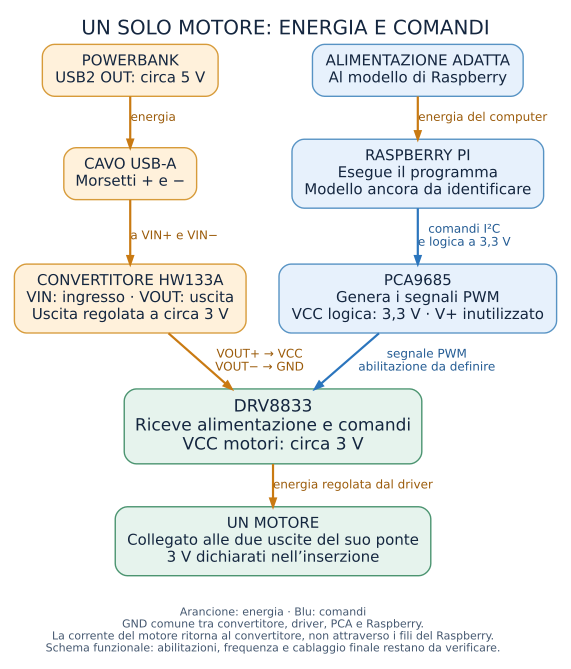

# HAMDA dalla A alla Z

Guida di lavoro del 3 novembre 2026. Obiettivo iniziale: un solo motore sul banco.

## Una guida per costruire il primo banco di prova

L'obiettivo è semplice da descrivere: dai un comando al computer, un motore
vibra e poi si ferma. Dopo averlo verificato, aggiungiamo un secondo motore
indipendente. Soltanto più avanti lavoriamo sul gruppo completo.

Questa guida mostra tutto il percorso. Alcuni passaggi sono già stati fatti;
altri richiedono di identificare il componente presente sul tavolo. Quando un
collegamento è ancora da definire, lo trovi scritto. Le voci **da confermare**
si completano sui componenti reali prima di alimentare quel ramo del circuito.

### Da dove riprendere oggi

**Il prossimo lavoro è preparare e controllare l'alimentazione di una sola
scheda DRV8833. Il motore deve restare scollegato.** Non occorre ancora
collegare Raspberry o PCA9685. I passaggi operativi sono nelle fasi 7 e 8.

Le letture riportate durante il lavoro sono:

- Porta USB2 del powerbank: **5,089 V** dichiarati nella misura.
- Uscita del convertitore: **3,029 V in continua a vuoto**, documentati con visibilità
  ancora parziale dei collegamenti.
- Un'altra lettura era **2.404**, con unità non chiarita. Non permette di
  diagnosticare la prima porta USB; non viene usata per alimentare questo banco.

Conoscere una tensione non dimostra quanta corrente l'alimentazione riesca a
fornire durante l'avvio dei motori. La prova attuale resta senza motore.

## Il progetto in una pagina



Lo schema distingue **energia** e **comandi**. Leggilo insieme ai due percorsi
seguenti. I punti ancora aperti richiedono una verifica prima del collegamento.

### Percorso dell'energia per il banco motore

```text
Powerbank, porta USB2 scelta
  → adattatore USB con morsetti + e −
  → ingresso VIN del convertitore
  → uscita VOUT del convertitore, misurata attorno a 3 V
  → alimentazione VCC e GND della singola scheda driver identificata
  → coppia di uscite del driver
  → due terminali del motore, nella fase successiva
```

### Percorso dei comandi, da completare

```text
Programma Python sul Raspberry
  → collegamento I²C
  → PCA9685
  → segnali di comando agli ingressi del driver identificato
  → pilotaggio del motore
```

Il Raspberry avrà la propria alimentazione appropriata. L'uscita regolata per
il motore **non va usata per alimentare il Raspberry**.

**Chi fa che cosa:** tu prepari i pezzi, realizzi i collegamenti e riporti le
misure; io traduco quei dati nello schema verificato, preparo il software e
ti indico la prova successiva. La guida serve a conoscere fin da subito
l'intero percorso, anche mentre lavoriamo su una sola fase.

## Fase 1 — Preparare il tavolo

1. Libera una zona di lavoro stabile, asciutta e ben illuminata.
2. Tieni separati i componenti pronti da quelli ancora da identificare.
3. Disponi una sola PCA9685, una sola scheda driver e un solo motore.
4. Scollega powerbank, USB e ogni altra sorgente prima di cambiare i fili.
5. Prepara un modo accessibile per togliere fisicamente alimentazione al banco.

Il saldatore ha bisogno di un supporto stabile e di una superficie resistente
al calore. Tieni lontani carta e tessuti. Il cavo non deve poter trascinare il
saldatore mentre sposti un componente.

Lavora con ventilazione appropriata e tieni il viso fuori dal fumo. Usa gli
occhiali quando tagli le estremità dei fili. La punta resta calda anche dopo
lo spegnimento: si impugna soltanto il manico.

**Prima di passare avanti:** tutto il materiale da collegare è senza energia.
Il posto per riporre il saldatore è pronto. Il primo banco non si indossa.

## Fase 2 — Riconoscere i pezzi disponibili

| Pezzo | Che cosa sappiamo | Che cosa manca |
| --- | --- | --- |
| Motori | Sono dichiarati 50 motori a moneta; l'inserzione li presenta come 1027. | Tipo effettivo e corrente di funzionamento e avvio. |
| PCA9685 | Sono dichiarate 4 schede; ciascun circuito genera 16 segnali PWM. | Modello esatto delle schede, configurazione e indirizzi. |
| Moduli DM0018x8 | Ne sono dichiarati 12. | Identificazione: il nome non conferma funzione o numero di canali. |
| Una scheda fotografata | È serigrafata DRV8833 e ha due file di sei pin già saldate. | Collegamento verificato fra ingressi, uscite e abilitazione. |
| Convertitore | È stato indicato come HW133A/MP1584. | Verifica del modulo effettivo e capacità nel circuito finale. |
| Raspberry | La specifica originaria prevede Raspberry Pi 4. | Presenza, modello effettivo e sistema operativo. |

La singola scheda DRV8833 fotografata non identifica automaticamente tutti i
dodici moduli chiamati DM0018x8. Non estendiamo il suo schema a pezzi diversi.

L'inserzione dei motori riporta anche «3 V, 5 W, 10 A». Questi dati, presi come
specifiche dello stesso piccolo motore, sono incoerenti. La corrente reale
rimane sconosciuta. La scritta «3 V» è un'indicazione del venditore da
confrontare con dati affidabili, non una validazione del gruppo completo.

Fotografa fronte e retro delle schede con scritte leggibili. Conserva la foto
insieme al nome del pezzo. Serve a indicare esattamente il contatto corretto,
senza affidarsi all'orientamento ricordato a memoria.

## Fase 3 — Capire i nomi prima di collegare

Un componente può avere contatti con nomi simili a quelli di un altro, ma con
funzioni e tensioni differenti.

| Nome nel progetto | Significato |
| --- | --- |
| VIN+ e VIN− del convertitore | Ingresso dell'alimentazione da trasformare. |
| VOUT+ e VOUT− del convertitore | Uscita regolata da misurare prima del carico. |
| VCC della scheda DRV8833 | Alimentazione del driver e dei motori secondo il modulo identificato; nel banco si prepara la sorgente attorno a 3 V. |
| VCC della PCA9685 | Alimentazione della logica; nel collegamento previsto al Raspberry è 3,3 V. |
| V+ della scheda PCA9685 | Alimentazione distribuita verso i connettori di carico della scheda; in questa architettura rimane inutilizzata. |
| GND | Riferimento elettrico del circuito e ritorno dell'alimentazione nei rami previsti. |

**VCC non significa sempre la stessa tensione.** Non collegare insieme due
contatti soltanto perché portano entrambi quella scritta.

Le masse dei circuiti che scambiano segnali devono avere il riferimento comune
previsto dallo schema. Questo non significa far passare la corrente dei motori
attraverso i cavettini di massa del Raspberry. Il ritorno di potenza percorre
driver, fili di alimentazione e convertitore con il percorso dimensionato per
il carico. Il collegamento alla massa del Raspberry serve anche al riferimento
dei segnali, non ad alimentare i motori attraverso il computer.

I colori aiutano a seguire il percorso, ma non sostituiscono le etichette. Nelle
foto dell'uscita del convertitore il filo **blu è VOUT−**. Il filo blu di un
motore, invece, è un terminale del motore e non è automaticamente GND.

## Fase 4 — Saldature e connettori

Hai confermato saldatore e multimetro. Sono stati indicati Weller PU81 e filo
Weller da 0,5 mm, SCNM1, senza piombo e con flussante interno.

Il flussante aiuta lo stagno ad aderire ai metalli. Se ne occorre altro, deve
essere per elettronica: non usare prodotti acidi da idraulica. Temperatura e
tempo di contatto dipendono da punta, lega e giunzione; non c'è un numero
universale da copiare. Per la Weller e lo stagno già fotografati abbiamo usato
circa **350 °C come impostazione iniziale** per le piccole giunzioni del banco.
Se lo stagno non si distribuisce dopo pochi secondi, allontana la punta e lascia
raffreddare: si controllano pulizia, contatto e materiale prima di insistere.

Per la prima pratica, se disponibili, usa un filo di scarto o una millefori:

1. Fissa il pezzo, senza alimentazione e senza dita accanto alla zona calda.
2. Prepara la punta secondo le istruzioni della stazione.
3. Scalda il punto da unire e porta poco stagno sulla giunzione calda.
4. Allontana il filo di stagno e poi la punta.
5. Rimetti il saldatore nel supporto e lascia fermo il pezzo.
6. Controlla che lo stagno aderisca e che il filo non si muova nella giunzione.

Non esercitarti sui motori o sulle PCA. La DRV fotografata ha già i pin
saldati: non occorre rifarli senza un motivo.

Un connettore bianco a due poli non è automaticamente compatibile con una
presa per pin. Conta la distanza dei contatti, il tipo di terminale e la tenuta
meccanica. La parte di plastica da sola non dimostra la compatibilità.

**Maschio** indica il contatto metallico a pin. **Femmina** indica il contatto
metallico a foro che lo accoglie, anche quando entrambi sono nascosti in un
involucro bianco. Il genere si riconosce dai contatti. I piedini già montati
sul driver sono maschi: per infilarvi un cavetto serve una femmina compatibile.
Una coppia bianca può anche essere usata come giunzione fra due cavetti,
saldando al circuito soltanto le estremità libere dei fili.

**Prima di passare avanti:** il collegamento scelto tiene senza forzare e non
lascia parti metalliche capaci di toccarsi accidentalmente.

## Fase 5 — Preparare il multimetro DM6000AR

Il multimetro serve a rispondere a domande precise. Per ora useremo tensione
continua e controlli del circuito spento. Non iniziamo misurando la corrente.

### Misurare una tensione

1. Metti il puntale nero nella presa **COM**.
2. Metti il rosso nella presa **INPUT** usata per la tensione sul DM6000AR.
3. Seleziona la misura di tensione continua: simbolo V con linea continua e
   tratteggiata; verifica l'indicazione DC sul display.
4. Appoggia il nero al riferimento negativo previsto e il rosso al positivo.
5. Leggi numero e unità insieme. Distingui V da mV.

Una tensione si misura fra due punti, senza interrompere il filo. Mantieni i
puntali separati: le loro parti metalliche non devono unire contatti vicini.

### Controllare resistenza o continuità

Queste funzioni si usano **soltanto senza energia**. Scollega le sorgenti e
verifica che il circuito non abbia tensione residua prima del controllo.

1. Scegli Ω o la funzione di continuità appropriata.
2. Puntali separati: in resistenza, OL normalmente indica circuito aperto.
3. Puntali a contatto: il valore deve avvicinarsi a zero, con la resistenza
   dei puntali; la continuità può emettere un suono.
4. Controlla soltanto le coppie di punti definite dallo schema.

Tra VCC e GND i condensatori possono causare una lettura transitoria. Un
suono breve non dimostra da solo un corto; una lettura stabile va interpretata
con il circuito. Non è corretto pretendere che tutti i contatti adiacenti
risultino isolati: alcuni sono collegati per progetto.

**Zero volt e zero ohm sono due cose diverse.** Zero volt su una scheda spenta
indica assenza di tensione. Una lettura stabile vicina a zero ohm indica un
collegamento a resistenza molto bassa fra i due punti misurati. Per descrivere
un controllo servono sempre numero, unità e nomi dei due punti.

Non usare una presa o funzione di corrente collegando i puntali direttamente
fra positivo e negativo del powerbank. Creeresti un percorso in parallelo
inadatto alla misura e potenzialmente un cortocircuito.

## Fase 6 — Ritrovare il percorso USB → convertitore

Questa parte ricostruisce il banco già preparato, prima di aggiungere il driver.

L'adattatore USB-A fotografato ha cinque morsetti. Guardandolo **con il cavo
nero verso l'alto e i fori per i fili verso il basso**, da sinistra si leggono:

```text
S       +       D−       D+       −
1       2       3        4        5
```

Usiamo **il secondo, +, e il quinto, −**. D− e D+ sono linee dati; S riguarda
lo schermo. Il simbolo D− non identifica il negativo di alimentazione.

1. Scollega l'adattatore dal powerbank.
2. Segui il filo del morsetto **+** fino a **VIN+** del convertitore.
3. Segui il filo del morsetto **−** fino a **VIN−**. Nelle foto più recenti
   viene usato anche il blu per il negativo: contano le sigle e il percorso,
   non il colore preso da solo.
4. Se stai preparando i morsetti da zero, allenta le viti, inserisci rame
   corto e compatto e stringi. Nessun filamento deve uscire verso i vicini.
   Tira delicatamente il filo per controllare che sia trattenuto.
5. Sul convertitore ogni sigla ha due fori equivalenti: basta un foro del
   gruppo VIN+ e uno del gruppo VIN−. Fissa i fili con una connessione stabile.
6. Imposta il multimetro su V DC come nella fase 5. Lascia VOUT separato da
   driver e motore; inserisci la USB nella porta USB2 OUT.
7. Misura l'ingresso fra VIN+ e VIN−. Il riferimento osservato è circa 5 V.
8. Misura poi l'uscita: puntale rosso su **VOUT+**, nero su **VOUT−**.
9. Se occorre regolare, muovi pochissimo la vitina e guarda il display.
   Se il valore sale quando vuoi abbassarlo, inverti il senso. Non forzare
   il fine corsa e non far scivolare l'utensile sui componenti vicini.
10. Cerca circa **3,0 V**. La lettura già ottenuta è **3,029 V**, circa 3,03 V:
    è una regolazione a vuoto vicina all'obiettivo. Annota il valore e stacca
    la USB prima del collegamento successivo.

Il convertitore abbassa la tensione; non aumenta un ingresso insufficiente.
Il banco attuale non richiede di ripetere questa regolazione solo per ottenere
esattamente 3,000 sul display. La misura sotto carico verrà fatta in seguito.

**Prima di passare avanti:** il percorso entra in VIN, l'uscita VOUT è libera e
la lettura viene associata chiaramente ai punti su cui poggiano i puntali.

## Fase 7 — Preparare il collegamento al driver

Nella configurazione fotografata, l'uscita del convertitore usa **rosso su
VOUT+ e blu su VOUT−**. L'obiettivo è portare questi due punti a **VCC e GND
della singola DRV identificata**. Il motore resta fuori dal banco.

Ci sono due percorsi possibili. Selezionane uno dopo la prova meccanica a freddo.

| Percorso | Lato driver | Lato sorgente |
| --- | --- | --- |
| **A. Femmina compatibile sui pin esistenti** | Solo se la presa è davvero compatibile con i pin, del passo appropriato e stabile: rosso su VCC, nero su GND. | Rosso al VOUT+ del convertitore; nero al VOUT−, che nel cablaggio presente è raggiunto dal filo blu. |
| **B. Cavetto con connettore saldato** | Un cavetto con connettore maschio viene saldato ai punti identificati: rosso VCC, nero GND. | La femmina di alimentazione corrispondente porta rosso da VOUT+ e nero da VOUT−. |

La compatibilità di una femmina con pin da 2,54 mm va verificata sul pezzo
reale. Il corpo bianco e la possibilità di appoggiarlo sui pin non bastano.
Non piegare o spingere un contatto per adattarlo.

Per il percorso B, individua prima i punti corretti sulla foto della scheda.
La saldatura deve avere spazio sufficiente e non creare unione fra VCC e GND.
Non strappare i pin già montati per liberare un punto.

1. Scollega la sorgente e prepara il percorso scelto.
2. Controlla i contatti metallici delle due metà del connettore: il colore
   esterno non garantisce che rosso e nero si incontrino correttamente.
3. Verifica il percorso con continuità, senza energia, oppure misura la
   polarità sulla femmina libera prima di collegare il driver.
4. Per la misura alimentata a vuoto, evita che i puntali uniscano i contatti.
5. Scollega di nuovo la sorgente prima di inserire il connettore sulla scheda.

**Prima di passare avanti:** VCC riceverà il positivo e GND il negativo; il
connettore resta stabile e il motore è ancora scollegato.

## Fase 8 — Alimentare una DRV, senza motore

Questo è il passaggio operativo attuale. Non stiamo ancora provando a far
vibrare un motore.

1. Verifica che la scheda sia proprio quella DRV8833 identificata.
2. Tieni libere le uscite verso il motore e scollegati Raspberry e PCA.
3. Con il driver separato da ogni sorgente, controlla **VCC rispetto a GND**
   in Ω come nella fase 5. Se la lettura si stabilizza vicino a quella dei
   puntali uniti, si chiarisce il risultato prima di alimentare. Un transitorio
   causato dai condensatori va distinto da un valore stabile.
4. A sorgente scollegata, collega soltanto l'alimentazione preparata alla fase 7.
5. Ricontrolla visivamente VCC e GND. Riporta il multimetro su **V DC**.
6. Dai energia dalla porta scelta e misura **fra VCC e GND del driver**.
7. Confronta la misura con quella dell'uscita del convertitore. Annotala
   insieme ai punti di misura e all'unità.
8. Togli alimentazione prima di cambiare qualsiasi collegamento.

La lettura precedente di 3,029 V riguarda il convertitore. Questa nuova misura
serve a verificare che la tensione arrivi alla scheda con la polarità corretta.
Una misura corretta non dimostra ancora il funzionamento del driver o la
compatibilità con il motore. Un LED, se presente, non sostituisce la misura.

Se la lettura è inattesa, compaiono odore, fumo o riscaldamento anomalo,
interrompi l'alimentazione. Si controlla poi il circuito spento; non si prova
a correggere spostando un filo mentre il banco è alimentato.

**Risultato della fase:** una sola scheda riceve l'alimentazione verificata.
Nessun motore, nessuna prova indossata e nessun ponte di abilitazione improvvisato.

## Fase 9 — Preparare il Raspberry e il programma simulato

Prima identifichiamo il computer disponibile. La specifica parla di Raspberry
Pi 4, ma modello e sistema operativo attuali non sono confermati.

1. Individua la scheda e la scritta del modello.
2. Controlla se esiste già una microSD con sistema operativo e dati.
3. Se il sistema si avvia, conserva l'installazione presente e verifica Python.
4. Se serve installare Raspberry Pi OS, salva prima i dati della microSD:
   scrivere un'immagine può cancellarli. Scegli versione e procedura dopo aver
   riconosciuto il modello.

### Se viene confermato il Pi 4 e serve un sistema nuovo

1. Sul portatile apri [Raspberry Pi Imager](https://www.raspberrypi.com/software/),
   il programma ufficiale per preparare la microSD.
2. Nel programma seleziona il Raspberry effettivo e una versione di Raspberry
   Pi OS compatibile. Per iniziare con schermo e mouse è pratica la versione
   con desktop; la scelta definitiva dipende dal modello identificato.
3. Inserisci la microSD nel lettore e controlla quale unità stai selezionando:
   la scrittura cancellerà i dati di quella scheda.
4. Configura nome utente, password, lingua, fuso orario e Wi-Fi del luogo in cui
   userai il Raspberry.
5. Scegli come usarlo: monitor e tastiera sul Raspberry, oppure accesso remoto
   dal portatile. Nel secondo caso prepara l'accesso SSH durante l'installazione.
6. Scrivi la scheda, attendi la verifica del programma ed espellila correttamente.
7. A Raspberry spento, inserisci la microSD e prepara i collegamenti scelti.
8. Alimenta il Raspberry con una sorgente adatta al suo modello, distinta dal
   ramo a 3 V dei motori. Completa il primo avvio prima di aggiungere le schede.

Il **terminale** è la finestra in cui si scrivono i comandi del sistema.
Il prompt `hamda>` apparirà invece dentro il nostro programma. Quando compare
quel prompt scriverai i comandi HAMDA, non quelli di installazione del sistema.

Il programma disponibile si può scaricare da questo archivio:

[HAMDA_per_Codex_2026-10-30.zip](https://github.com/SchillaciLorenzo/Lorenzo-Schillaci/raw/refs/heads/download-hamda-20261030/HAMDA_per_Codex_2026-10-30.zip)

Estrai la cartella completa. Possiamo chiamarla `HAMDA` e metterla nella cartella
personale: `~/HAMDA` è soltanto una convenzione. Deve contenere insieme
`main.py`, la cartella `hamda`, la cartella `config` con `hardware.json` e i test.
Spostare soltanto `main.py` non basta.

Se hai messo la cartella nella posizione indicata, apri il terminale ed esegui
una riga alla volta:

```bash
cd ~/HAMDA
python3 --version
python3 main.py
```

Questa versione richiede Python 3.10 o successivo. La verifica storica è su
Python 3.12 nel cloud, non sul tuo Raspberry. Se usi Thonny, apri `main.py`
dalla cartella completa e scegli Esegui: i passaggi grafici non sono stati
provati nell'ambiente cloud.

Il simulatore usa soltanto la libreria standard di Python: questa versione
non richiede pacchetti aggiuntivi. Le dipendenze del futuro backend fisico
saranno preparate e documentate quando lo implementeremo.

**Solo nella simulazione**, quando compare `hamda>`, prova:

```text
status
on L1 30 1000
status
stop
quit
```

Il numero 30 e i 1000 millisecondi sono esempi virtuali, non impostazioni per
il motore reale. Dopo `quit`, dal terminale esegui:

```bash
python3 -m unittest discover -s tests -v
```

La verifica iniziale contava **49 test superati**. Controlla il riepilogo della
nuova esecuzione: quel risultato storico non garantisce il nuovo ambiente.

## Fase 10 — Collegare una PCA al Raspberry identificato

Questa fase richiede modello e orientamento del connettore del Raspberry
confermati. I numeri dei **pin fisici** indicano le posizioni sul connettore;
non sono la stessa cosa dei numeri GPIO usati da alcune librerie.

**Solo se è confermato un Raspberry Pi 4 con il connettore standard e il pin 1
identificato correttamente**, il riferimento iniziale è:

| Pin fisico Raspberry | Funzione | Destinazione sulla PCA identificata |
| --- | --- | --- |
| 1 | 3,3 V | VCC della logica PCA. |
| 3 | SDA | SDA. |
| 5 | SCL | SCL. |
| 6 | GND | GND. |

Si collega a sistema spento. **V+ della PCA rimane inutilizzato** in questa
architettura. Non scegliere una sorgente da 5 V per VCC della PCA come valore
predefinito e non portarvi la sorgente da 3 V preparata per il driver.

Dopo il cablaggio verificato, abilita I²C nel sistema operativo effettivo.
Il programma `i2cdetect` richiede il pacchetto `i2c-tools`; installazione e
abilitazione dipendono dalla distribuzione. Questi prerequisiti non sono stati
eseguiti sul tuo Raspberry.

Se il sistema confermato è Raspberry Pi OS, la procedura abituale è:

```bash
sudo apt update
sudo apt install i2c-tools
sudo raspi-config
```

Nel programma di configurazione cerca **Interface Options → I2C** e abilita
l'interfaccia. Se viene richiesto un riavvio, salva il lavoro e riavvia. I nomi
possono cambiare con la versione: se la schermata è diversa si usa la procedura
della versione effettiva.

Con una sola PCA collegata, senza motore, e dopo aver confermato che il bus è
quello corretto, il comando per il bus 1 è:

```bash
i2cdetect -y 1
```

Confronta l'indirizzo rilevato con la configurazione reale della scheda. Non
assegniamo qui un indirizzo per supposizione. Vedere una risposta I²C verifica
la comunicazione di base, non il pilotaggio del motore.

Un indirizzo frequente per una scheda PCA9685 non modificata è `0x40`: è un
valore atteso da confrontare con la scansione, non una misura già fatta.
Cominciamo con **una sola PCA**: due schede con lo stesso indirizzo non
diventano due dispositivi distinguibili dal programma.

## Fase 11 — Completare ingressi e software reale

Prima del motore bisogna definire il comando della DRV fotografata.

Il circuito DRV8833 ha un ingresso **nSLEEP**: basso disattiva il circuito.
Questo non prova che i contatti o il ponte **J1/EN** della tua scheda abbiano
un determinato collegamento. Prima di fare un ponte si verifica il modulo.
Un ingresso non va lasciato in uno stato elettrico indefinito.

### Collegamenti di comando progettati per il primo canale

Questa tabella mostra la soluzione prevista con un DRV8833 usato in un solo
verso. Prima di eseguirla si confermano le corrispondenze sul modulo reale e
la gestione di nSLEEP/J1. **Non ponticellare J1 per tentativi.**

| Origine o stato | Destinazione prevista | A cosa serve |
| --- | --- | --- |
| Segnale del canale 0 della PCA, indicato S o PWM sulla fila corretta | IN1 del driver, dopo conferma del canale | Regolare il comando del primo motore. |
| GND comune | IN2 del relativo ponte | Mantenere definito l'altro ingresso per il funzionamento in un solo verso. |
| GND comune | IN3 e IN4, se il secondo ponte non è usato | Mantenere spento il canale non utilizzato. |
| Comando di abilitazione verificato | nSLEEP, secondo il circuito della scheda | Tenere il driver disabilitato durante la preparazione e abilitarlo deliberatamente. |
| nFAULT, uscita diagnostica del driver | Eventuale ingresso diagnostico del controllore, con circuito appropriato | Rilevare un guasto; nFAULT non è il comando di accensione. |

Il motore riceve energia dal driver. Il filo S/PWM della PCA trasporta un
comando: non va usato per alimentare direttamente il motore.

L'ingresso **OE** della PCA può disabilitarne le uscite quando è alto. Prima
di usarlo come arresto si verificano configurazione e stato delle uscite
disabilitate; gli ingressi del driver devono restare in uno stato spento
definito.

La sequenza prevista è: driver disabilitato → inizializzazione → tutte le
uscite esplicitamente spente → abilitazione controllata. La frequenza PWM è
comune ai 16 canali della stessa PCA e verrà scelta per motori e driver reali.

La coppia di uscite indicata come OUT1/OUT2 deve essere ricondotta al canale
effettivo e alla relativa coppia di ingressi, per esempio AIN1/AIN2, attraverso
documentazione e scheda. Non colleghiamo un motore a due uscite di canali
diversi. I due fili del motore vanno alla sua coppia del ponte: il blu del
motore **non va considerato automaticamente il negativo dell'alimentazione**.

Prima dell'attivazione completa questa tabella con dati verificati:

| Parametro | Dato da confermare |
| --- | --- |
| Motore | Tipo, tensione nominale, corrente di lavoro e avvio. |
| Driver | Modello, canale, ingressi, uscite e stato di abilitazione. |
| PCA | Indirizzo, canale usato e livello logico compatibile. |
| Comando | Frequenza PWM e combinazione degli ingressi appropriata. |
| Prova | Durata e intensità iniziali compatibili con il motore reale. |
| Alimentazione | Capacità del banco e percorso dei ritorni. |
| Arresto | Modalità software e interruzione fisica accessibile. |

Il software disponibile implementa la simulazione. Occorre ancora scrivere il
backend fisico, scegliere e verificare le librerie, configurare I²C e provare
la gestione degli errori. Non esiste un comando `--hardware` già pronto.
Cambiare una voce nel JSON non crea questa funzione.

Il backend dovrà partire con uscite spente e comandare lo spegnimento in uscita.
Se il bus I²C si interrompe, la PCA può continuare a produrre il PWM impostato:
un errore del programma non garantisce lo spegnimento fisico. Per questo il
banco deve poter essere disalimentato indipendentemente dal software.

## Fase 12 — Prima vibrazione di un solo motore

Questa fase comincia quando tabella, circuito e backend sono completati.

1. Togli energia e collega il motore alla coppia di uscite identificata.
2. Disponilo sul banco, senza indossarlo e senza tirare i piccoli fili.
3. Ricontrolla che i ritorni dei motori non passino attraverso il Raspberry.
4. Dai energia secondo la procedura verificata: il motore deve restare spento.
5. Esegui il primo comando con i parametri reali scelti nella fase 11.
6. Verifica la vibrazione e poi lo spegnimento alla scadenza.
7. Prova l'arresto anticipato e la disponibilità dell'interruzione fisica.
8. Annota impostazioni, comportamento e misure effettive.

Non inseriamo qui valori arbitrari di durata o intensità. Il successo è una
risposta fisica coerente e ripetibile, non soltanto una conferma sullo schermo.

La misura della corrente potrà aiutare a dimensionare il gruppo, ma richiede
una procedura dedicata e la corretta presa del multimetro. Concettualmente
si inserisce lo strumento **in serie**, interrompendo il ramo da misurare:

```text
Sorgente → strumento di corrente → carico → ritorno alla sorgente
```

Questo è il principio, non ancora una ricetta eseguibile. Portata, presa e
limiti vanno scelti per strumento e carico. Non tentare una misura di stallo
bloccando il motore per ricavare un dato mancante.

## Fase 13 — Due motori indipendenti

L'aggiunta del secondo motore serve a provare l'indipendenza dei comandi.
Richiede un secondo canale fisico identificato e un'alimentazione compatibile.

1. A circuito spento aggiungi il secondo motore secondo lo schema verificato.
2. Controlla prima il primo lasciando il secondo spento.
3. Controlla il secondo lasciando il primo spento.
4. Prova comandi differenti e scadenze separate.
5. Verifica che STOP arresti entrambi e che l'avvio resti senza attivazioni.
6. Controlla il comportamento dell'alimentazione con il nuovo carico.

Collegare due motori allo stesso segnale può farli reagire insieme, ma non
dimostra l'indipendenza. Anche due canali indipendenti sullo stesso driver
condividono risorse elettriche e limiti termici del componente.

**Prima di passare avanti:** ogni motore risponde soltanto al comando previsto
e non compaiono effetti inattesi sull'altro o sul Raspberry.

## Fase 14 — Crescere al gruppo e preparare gli esperimenti

Si aumenta gradualmente il numero di motori, ricontrollando cablaggi,
assorbimenti, alimentazione e arresto. Possedere 50 motori non significa
doverli collegare insieme.

Il software attuale identifica 16 motori virtuali. Il passaggio a 16 fisici
richiede mappa dei canali reali, capacità dei driver verificata e prove sul
gruppo. L'espansione a 32 è proposta, non implementata. Richiede anche la
distinzione fra scheda PCA e canale, indirizzi separati, nuove configurazioni
e nuovi test. I dodici DM0018x8 non consentono ancora un conteggio affidabile
dei canali motore.

Nella configurazione simulata iniziale, **L1–L8** usano i canali 0–7 e
**R1–R8** i canali 8–15. Questi nomi sono etichette logiche: la posizione
anatomica esatta resta da scegliere e documentare.

Per capire la crescita, nell'architettura con **un segnale PWM per motore** e
driver DRV8833 effettivamente identificati a due canali:

| Obiettivo | Segnali PWM | PCA minime per i comandi | DRV8833 a due canali |
| --- | --- | --- | --- |
| 1 motore | 1 | 1 | 1, con un canale usato |
| 2 motori indipendenti | 2 | 1 | 1, con entrambi i canali verificati |
| 16 motori indipendenti | 16 | 1 | 8 |
| 32 motori indipendenti | 32 | 2 | 16 |

È un conteggio della capacità di comando, non una verifica della corrente
disponibile. Non permette di dire quanti motori possano pilotare i dodici
DM0018x8 finché non vengono identificati.

Per più PCA si assegna a ciascuna un indirizzo I²C distinto, secondo i suoi
ponticelli verificati, e il programma registra **scheda + canale** per ogni
motore. La frequenza resta condivisa fra i canali della singola scheda.

Prima del gruppo si misurano assorbimenti, comportamento durante gli avvii,
cadute di tensione e temperatura. Si dimensionano poi alimentazione, fili,
connettori e protezioni. La scritta 65 W sul powerbank e il numero di schede
disponibili non forniscono da soli questo dimensionamento.

Dopo il controllo fisico arrivano pattern, eventi e registrazione delle prove.
Il log dovrebbe conservare comando, motori, intensità, durata, timestamp e
errori. Le scelte dipendono dagli esperimenti, non vanno confuse con un
linguaggio aptico già validato.

Per ogni fase conserva foto del banco e una breve nota. Una frase utile è:
«Ho misurato questo valore, con questa unità, fra questi due punti, in questa
configurazione». Consente di riprendere il lavoro senza ricostruire i fili.

## Glossario essenziale

| Parola | Significato pratico |
| --- | --- |
| V, volt | Unità della tensione. Serve a confrontare sorgente e componente. |
| A, ampere | Unità della corrente che attraversa un ramo. |
| mA | Milliampere: 1000 mA corrispondono a 1 A. |
| DC | Corrente continua; qui identifica la misura di tensione dell'alimentazione. |
| PWM | Segnale che alterna acceso e spento; conta anche la frequenza delle alternanze. |
| Duty cycle | Quota di tempo in cui il PWM è attivo. Non misura la vibrazione percepita. |
| I²C | Collegamento con cui il Raspberry comunica con la PCA. |
| Driver | Circuito che pilota il carico del motore a partire dai segnali. |
| Ponte | Circuito di uscita del driver; i terminali motore non sono automaticamente positivo e GND fissi. |
| Backend | Parte del programma che trasforma il comando astratto in scritture alle uscite reali o simulate. |

## Il punto di arrivo di questa guida

Il percorso è completo come sequenza di lavoro. Le parti elettriche ancora
aperte si completano prima di diventare collegamenti. Il passaggio alla
struttura da indossare arriva dopo le prove sul banco: si definiscono
posizione dei motori, isolamento, fissaggio dei fili e livelli percepiti.

### Scheda da compilare mentre costruiamo

| Controllo | Stato o valore attuale |
| --- | --- |
| Alimentazione USB scelta | USB2 OUT, circa 5,089 V riferiti. |
| Uscita del convertitore senza carico | 3,029 V DC osservati. |
| Collegamento definitivo VIN/VOUT e connettori | Da completare e fissare. |
| Tensione VCC–GND sul driver | Da misurare. |
| nSLEEP/J1 e coppie dei ponti | Da confermare. |
| Raspberry e sistema operativo | Da identificare. |
| Indirizzo PCA e pin di segnale | Da verificare. |
| Frequenza PWM e parametri del primo impulso | Da scegliere sui dati reali. |
| Corrente di lavoro e avvio di un motore | Da misurare o ottenere da fonte affidabile. |
| Backend fisico e arresto | Da realizzare e verificare. |
| Primo motore, secondo motore, gruppo | Prove ancora da eseguire. |

**Oggi:** controlla il percorso dal convertitore al connettore, poi misura
l'alimentazione sulla sola DRV seguendo le fasi 7 e 8. Il motore rimane
scollegato. Da quel risultato si costruisce il passo successivo.
